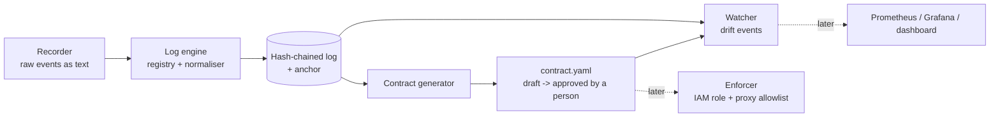

# Architecture

## Pipeline



Solid arrows exist in v0.1.0; dotted ones are later releases (`ROADMAP.md`).

The rule that keeps releases stacking: **stages talk only through four plain data shapes** (below). A new release
adds a producer or consumer of these shapes; it does not reach into another stage's internals.

## The four shared shapes

1. **Raw event**: one string. A text line, or one compact JSON object (CloudTrail record).
2. **Record** (output of the log engine, input to everything after it):
   ```json
   {"format": "egress_proxy",
    "event": {"metadata": {"original_time": "..."}, "dst_endpoint": {"hostname": "images.shopapp.example", "port": 443}},
    "raw": "<the raw event, always kept>"}
   ```
   `event` is OCSF-shaped (nested attributes). `format` is the registry format that matched, or `fallback`.
3. **Chain entry** (one line of the log file, JSON Lines):
   `{"i": 7, "prev": "<hex>", "record": {...}, "hash": "<hex>"}` with `hash = SHA-256(prev || canonical_json(record))`,
   `prev` of entry 0 = 64 zeros. Canonical JSON = sorted keys, no spaces, UTF-8.
4. **Contract** (YAML, `version: 1`): `application`, `status` (`draft` or `approved`), `allowed_domains`,
   `allowed_actions`, plus `source` (which log head it was built from) and `evidence` (counts, not enforced).

What counts as a destination or a cloud action is defined once, in `leastpriv/observe.py`:
destination = `dst_endpoint.hostname`; cloud action = `api.service.name` + `:` + `api.operation`.

## Modules

| Folder / file             | Job                                                                    | Public entry points |
|---------------------------|------------------------------------------------------------------------|---------------------|
| `leastpriv/engine/`       | registry loading, normaliser, raw-event readers                        | `load_registry`, `Normaliser.normalise`, `iter_raw_events` |
| `leastpriv/formats/`      | one JSON file per format; **no code per format**                       | (data) |
| `leastpriv/integrity/`    | append-only chained log, anchor, verifier                              | `ChainedLog`, `verify`, `read_entries`, `write_anchor` |
| `leastpriv/recorder/`     | sources of raw events; `Recorder` protocol                             | `AuditRecorder` (stand-in) |
| `leastpriv/contract/`     | draft from records, YAML read/write, approval, pattern matching        | `generate`, `dump`, `load`, `Contract` |
| `leastpriv/watcher/`      | compare entries with a contract                                        | `check_entries` |
| `leastpriv/pipeline.py`   | `ingest()` glue used by the CLI, demo, experiments and tests           | `ingest`, `build_registry` |
| `leastpriv/cli.py`        | argparse front end, exit codes                                         | `main` |
| `leastpriv/demo/`         | ShopApp-mini + traffic sources + the `demo` scenario                   | `run_demo` |
| `experiments/`            | runners that reproduce the paper's experiments                         | `e3_integrity`, `e6_pilot` |

## Extension points (how to add things without touching existing code)

- **New log format**: add `leastpriv/formats/<name>.json` (see the docstring of `engine/registry.py`) and a test. Teams
  can also keep private formats in another folder and pass `--registry DIR`; a format with the same name overrides.
- **New recorder** (egress proxy, CloudTrail puller): produce raw events as text in a registered format; the rest of
  the pipeline does not change. If the output shape is new, add a format file for it.
- **New consumer of the log** (enforcer, metrics exporter): read with `integrity.read_entries` **after** `verify`.
- **New contract field**: add it to `Contract` with a default so old contract files still load; bump `version` only for
  breaking changes.

## Compatibility promise inside 0.x

Within 0.x a release may add commands, formats, fields and modules. It must not silently change: the chain entry
shape or hash formula (old logs must keep verifying), the contract `version: 1` meaning, CLI command names and exit
codes, or the Record shape. A deliberate break needs a `BREAKING` line in `CHANGELOG.md` and a migration note.

## Known gaps in v0.1.0

- `metadata.original_time` is kept as the original text; no epoch `time` yet (syslog has no year).
- Apache `severity` holds the raw level (`notice`, `error`); mapping to OCSF's severity values is a v0.2 item.
- Re-opening a log continues its chain without re-verifying the old entries; no per-record `fsync`.
- OCSF attribute names for the proxy and CloudTrail formats are unchecked against `schema.ocsf.io`.
- CloudTrail `errorCode` (denied calls) is ignored.
